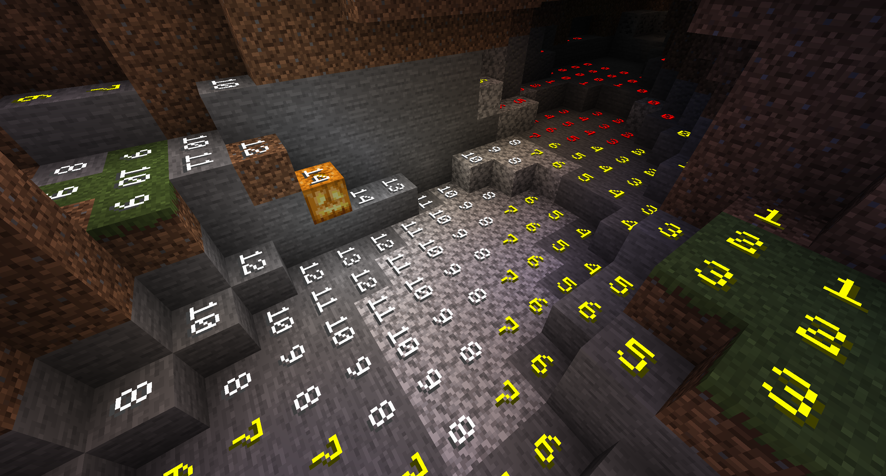
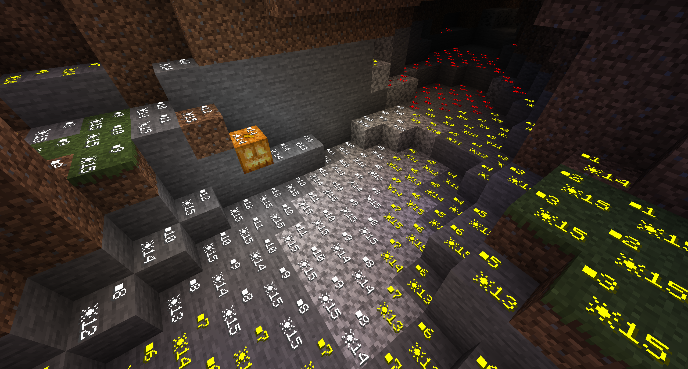

# LightLevel

LightLevel adds an in-game overlay that displays the light level on every block where a hostile mob could spawn, within a 16-block radius of the player.

## Requirements

* Minecraft 26.3
* [Fabric Loader](https://fabricmc.net/use/) 0.20.1 or newer
* [Fabric API](https://modrinth.com/mod/fabric-api) 0.164.0 or newer
* Java 25

## Controls

| Key   | Action                                                       |
|-------|--------------------------------------------------------------|
| `F9`  | Cycle the overlay: off, basic, advanced, then back to off    |
| `F10` | Open the color settings                                      |

Both keys can be rebound in the Minecraft controls menu, under the "Light Level" category.

## Overlay modes

### Basic mode

Basic mode displays the block light level reaching the block. The color represents the possibility of hostile mobs spawning there:

* White: A mob cannot spawn.
* Yellow: A mob can spawn during the night.
* Red: A mob can always spawn.

The overlay only appears on blocks where Minecraft's own spawn rules allow a hostile mob to spawn. This excludes surfaces such as glass, leaves, slabs and light sources, as well as underwater spots, spaces without enough headroom, and spaces blocked by redstone components or similar blocks. Other spawn conditions, such as biome, difficulty or mob caps, are not taken into account.



### Advanced mode

Advanced mode uses the same colors and spawn rules as Basic mode, but each block displays two numbers: the block light (denoted by the square symbol) and the sky light (denoted by the sun symbol).



## Changing the colors

Press `F10` to open the color settings. Each of the three colors (no spawns, night only, any time) has:

* a hex field (for example `FF8800`), which updates the overlay immediately when the value is valid,
* a color preview,
* a Reset button that restores the default color.

Closing the screen with Done or `Esc` saves the colors to `config/lightlevel.json` in your Minecraft folder. You can also edit that file by hand.

## Building

```
./gradlew build
```

The built jar is placed in `build/libs`. Use `./gradlew runClient` to start a development client.

# Modpack usage

Use this mod or the code however you want (within the license).

# Shoutout

Original repo was cloned years ago and only now have I had time to work on it. Shout out to Parzivail Modding Team for the original mod.
